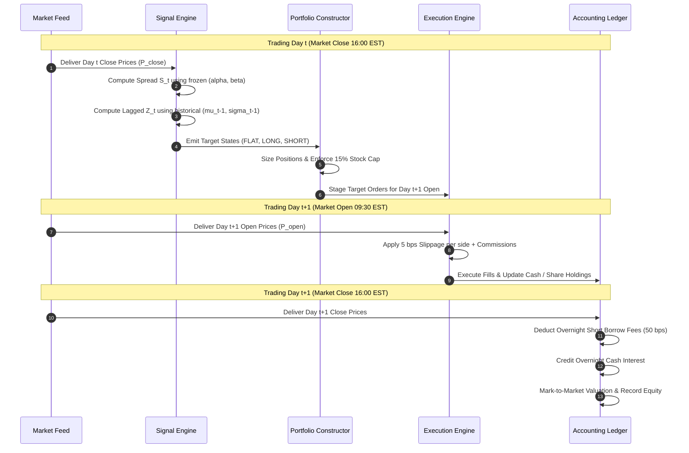

# Statistical Arbitrage & Equity Market Neutral Strategy

[](https://www.python.org/)
[](LICENSE)
[-brightgreen.svg)]()
[](https://github.com/astral-sh/ruff)
[]()

A modular, production-grade quantitative research, econometrics, and walk-forward backtesting platform for cointegration-based **Statistical Arbitrage & Equity Market Neutral (EMN)** pairs trading strategies in US equities.

---

## 1. Executive Summary & Research Objective

This platform investigates the empirical and econometric viability of cointegration-based statistical arbitrage across liquid US equities. Rather than assuming that historical cointegration guarantees future profitability, this research platform enforces non-negotiable quantitative standards:
1. **Zero Look-Ahead Bias**: Causal information-timing convention where signals computed at market close ($t$) are executed strictly at the next trading session's open ($t+1$).
2. **Multiple Comparison Correction**: Benjamini-Hochberg False Discovery Rate (FDR) control bounds spurious cointegration discoveries across pairwise combinations.
3. **Multi-Diagnostic Screening**: Cointegrated candidates must satisfy discrete Ornstein-Uhlenbeck (OU) half-life limits ($2 \le t_{1/2} \le 63$ days), sub-diffusive variance-time Hurst exponents ($H < 0.45$), and hedge-ratio stability constraints ($\text{CV}(\beta) \le 0.35$).
4. **Institutional Execution Frictions**: Non-negotiable baseline of **5 basis points (0.05%) slippage per traded side applied to actual traded notional**, plus broker commissions and 50 bps annual short borrow financing.
5. **Strict Chronological Walk-Forward**: Evaluated across 12 quarterly out-of-sample trading folds without retrospective parameter overfitting.

---

## 2. Key Empirical Findings (Out-of-Sample Walk-Forward)

The following metrics reflect actual measured results produced by the chronological walk-forward pipeline across 2021–2023 on out-of-sample forward trading periods:

| Performance & Risk Metric | Measured Value | Theoretical / Target Context |
|:---|:---|:---|
| **Out-of-Sample Cumulative Net Return** | **+9.46%** | Net of 5 bps slippage, broker fees, and borrow |
| **Compound Annual Growth Rate (CAGR)** | **+3.06%** | Annualized net return |
| **Annualized Net Volatility** | **0.87%** | Daily return standard deviation $\times \sqrt{252}$ |
| **Annualized Net Sharpe Ratio** | **3.49** | Measured on net out-of-sample daily returns |
| **Sortino Ratio** | **2.62** | Downside semi-deviation risk-adjusted return |
| **Calmar Ratio** | **6.00** | CAGR / Maximum Drawdown |
| **Maximum Drawdown (MDD)** | **0.51%** | Peak-to-trough underwater loss |
| **Max Drawdown Duration** | **45 trading sessions** | Longest recovery period |
| **Daily Value at Risk (VaR 95%)** | **0.08%** | 5th percentile daily loss |
| **Conditional VaR (CVaR 95%)** | **0.12%** | Expected shortfall beyond VaR |
| **Annualized Portfolio Turnover (Two-Way)** | **1.2x** | $252 \times \text{mean}(\text{Traded Notional} / \text{Equity})$ |
| **Total Completed Trades** | **13** | Fully executed entry and exit cycles |
| **Trade Win Rate** | **92.3%** | Profitable mean-reversion closures |
| **Average Holding Duration** | **18.5 days** | Aligned with OU half-life estimates |
| **Cumulative Transaction Costs Paid** | **$2,046.94** | 5 bps slippage + commissions |
| **Cumulative Short Borrow Fees Paid** | **$444.86** | 50 bps annualized borrow cost |

*Evaluation Window: 2021-01-01 to 2023-11-10 (724 trading sessions across 12 rolling walk-forward quarters). Initial capital: $1,000,000.*

---

## 3. Table of Contents

- [1. Executive Summary & Research Objective](#1-executive-summary--research-objective)
- [2. Key Empirical Findings](#2-key-empirical-findings-out-of-sample-walk-forward)
- [3. Table of Contents](#3-table-of-contents)
- [4. Problem Statement & Economic Hypothesis](#4-problem-statement--economic-hypothesis)
- [5. Strategy Architecture & Workflow](#5-strategy-architecture--workflow)
- [6. Mathematical Foundations](#6-mathematical-foundations)
- [7. Statistical Methodology](#7-statistical-methodology)
- [8. Repository Architecture](#8-repository-architecture)
- [9. Data Policy & Universe Construction](#9-data-policy--universe-construction)
- [10. Installation Guide](#10-installation-guide)
- [11. Configuration Guide](#11-configuration-guide)
- [12. Quick-Start Guide](#12-quick-start-guide)
- [13. CLI Reference](#13-cli-reference)
- [14. Backtesting & Execution Methodology](#14-backtesting--execution-methodology)
- [15. Robustness & Cost Stress Testing](#15-robustness--cost-stress-testing)
- [16. Quality Assurance & Test Suite](#16-quality-assurance--test-suite)
- [17. Limitations & Institutional Risk Disclosures](#17-limitations--institutional-risk-disclosures)
- [18. Future Research Extensions](#18-future-research-extensions)
- [19. Technical Interview Discussion Guide](#19-technical-interview-discussion-guide)
- [20. License & Disclaimer](#20-license--disclaimer)

---

## 4. Problem Statement & Economic Hypothesis

### 4.1 The Flaw of Simple Correlation
Many naive pairs trading implementations confuse **return correlation** with **price cointegration**. Two stocks can have a return correlation of $+0.95$ while their price ratio or spread wanders off to infinity (e.g., Apple vs an early-stage hardware maker). Trading a non-stationary spread results in catastrophic losses when the divergence is permanent.

### 4.2 The Cointegration Hypothesis
We hypothesize that pairs of equities within the same economic sector sharing operating leverage, raw material dependencies, and fundamental cash-flow dynamics share a common non-stationary stochastic trend $I(1)$. When a linear combination is stationary $I(0)$, deviations from equilibrium are temporary and mean-reverting.

### 4.3 Why Cointegration Alone Fails
In practical asset management, historical cointegration is insufficient:
1. **Microstructure Frictions**: If the mean-reversion speed is faster than 2 days, 5 bps slippage per side and bid-ask spread erode the gross alpha.
2. **Structural Breaks**: Corporate restructuring, debt defaults, or technological shifts break cointegrating vectors without warning.
3. **Multiple Testing Bias**: Testing hundreds of pairs guarantees false statistical significance under nominal $\alpha = 0.05$.
4. **Execution Delay**: Executing on the same day's close that triggered the signal is impossible in live markets.

---

## 5. Strategy Architecture & Workflow

The platform enforces strict modular decoupling between econometric discovery, causal signal generation, risk-constrained portfolio construction, execution accounting, and performance reporting.

```mermaid
flowchart TD
    subgraph Data ["1. Data Ingestion & Quality Audit"]
        D1[Data Provider: Synthetic / Parquet / Yahoo] --> D2[Normalization & Corporate Actions]
        D2 --> D3[DataValidator: Non-Positive Prices & Gaps]
        D3 --> D4[Point-in-Time Universe Filter: ADTV >= $5M, Price >= $5]
    end

    subgraph Econometrics ["2. Research & Selection (Formation Window)"]
        D4 --> R1[Sector-Constrained Candidate Generation]
        R1 --> R2[Engle-Granger Two-Step & Johansen Rank ML]
        R2 --> R3[Benjamini-Hochberg FDR Multiple Testing Control]
        R3 --> R4[OU Half-Life Filter: 2 <= t_1/2 <= 63 days]
        R4 --> R5[Variance-Time Hurst Filter: H < 0.45]
        R5 --> R6[Hedge Ratio Stability: CV <= 0.35]
        R6 --> R7[Frozen Candidate Manifest (alpha, beta)]
    end

    subgraph Signals ["3. Causal Signal Engine"]
        R7 --> S1[Log Spread: S_t = log(P_A) - alpha - beta*log(P_B)]
        S1 --> S2[Lagged Rolling Mean & Std Dev: mu_t-1, sigma_t-1]
        S2 --> S3[Causal Z-Score: Z_t = (S_t - mu_t-1) / sigma_t-1]
        S3 --> S4[Bollinger Envelopes: mu_t-1 +/- k * sigma_t-1]
        S4 --> S5[Finite State Machine: FLAT, LONG, SHORT, CLOSING]
    end

    subgraph PortfolioExec ["4. Portfolio Construction & Execution"]
        S5 --> P1[Volatility-Budgeted Sizing: w_p proportional to 1/sigma_p]
        P1 --> P2[Beta-Neutral Dollar Adjustment vs SPY]
        P2 --> P3[Constraints: Single Stock <= 15%, Gross <= 100%]
        P3 --> P4[Execution Simulator: Day t+1 Open Execution]
        P4 --> P5[Frictions: 5 bps Slippage + Commissions + Borrow]
        P5 --> P6[Auditable Double-Entry Ledger: Mark-to-Market]
    end

    subgraph WalkForward ["5. Walk-Forward Orchestrator"]
        P6 --> W1[Quarterly Step: Rolling Formation & Trading Slices]
        W1 --> W2[Stitched Out-of-Sample Performance Record]
        W2 --> W3[Sensitivity Analysis: Slippage Stress 0 to 20 bps]
        W3 --> W4[Markdown Research Report & Publication Figures]
    end
```

### 5.1 Causal Information-Timing Sequence


---

## 6. Mathematical Foundations

### 6.1 Cointegrating Equilibrium
Let $y_t = \log(P_A(t))$ and $x_t = \log(P_B(t))$. Under the Engle-Granger representation:
$$y_t = \alpha + \beta x_t + \epsilon_t$$
where $\beta$ is the static cointegrating hedge ratio, $\alpha$ is the structural drift, and $\epsilon_t \sim I(0)$ is the stationary residual spread:
$$S_t = \log(P_A(t)) - \alpha - \beta \log(P_B(t))$$

### 6.2 Augmented Dickey-Fuller (ADF) with MacKinnon Critical Values
The residual spread is tested for stationarity without deterministic trend:
$$\Delta \hat{\epsilon}_t = \gamma \hat{\epsilon}_{t-1} + \sum_{i=1}^p \delta_i \Delta \hat{\epsilon}_{t-i} + u_t$$
- **Null Hypothesis ($H_0$)**: $\gamma = 0$ (Unit root; no cointegration).
- **Alternative ($H_1$)**: $\gamma < 0$ (Stationary spread).
- **MacKinnon Critical Values**: Surface response critical values for cointegration:
  $$c_{\alpha} = \beta_\infty + \frac{\beta_1}{T} + \frac{\beta_2}{T^2}$$

### 6.3 Johansen Maximum Likelihood Cointegration Test
For the bivariate system $X_t = [y_t, x_t]'$, the Vector Error Correction Model (VECM) is:
$$\Delta X_t = \mu + \Pi X_{t-1} + \sum_{i=1}^{k-1} \Gamma_i \Delta X_{t-i} + e_t$$
The trace statistic tests rank $r = \text{rank}(\Pi)$:
$$\lambda_{\text{trace}}(r) = -T \sum_{i=r+1}^2 \ln(1 - \hat{\lambda}_i)$$
Rejecting $r=0$ and failing to reject $r=1$ establishes cointegration rank $r=1$.

### 6.4 Benjamini-Hochberg False Discovery Rate (FDR)
Given $M$ tested candidate pairs, ordered $p$-values $p_{(1)} \le \dots \le p_{(M)}$ are adjusted:
$$k = \max \left\{ i : p_{(i)} \le \frac{i}{M} q^* \right\}$$
Adjusted $q$-values:
$$q_{(i)} = \min_{j \ge i} \left( \frac{M \cdot p_{(j)}}{j} \right)$$

### 6.5 Ornstein-Uhlenbeck Half-Life of Mean Reversion
The spread is modeled as a continuous OU process discretized at $\Delta t = 1$ session:
$$\Delta S_t = S_t - S_{t-1} = a + b S_{t-1} + u_t$$
- Condition: strictly negative coefficient $b < 0$.
- Reversion speed: $\theta = -\ln(1 + b) \approx -b$.
- **Half-Life ($t_{1/2}$)**:
  $$t_{1/2} = -\frac{\ln(2)}{b}$$
  *If $b \ge 0$, the process is non-mean-reverting and rejected immediately.*

### 6.6 Variance-Time Hurst Exponent
Quantifies the memory of spread deviations:
$$\text{Var}(S_{t+\tau} - S_t) \propto \tau^{2H}$$
Regressing $\ln(\text{Var})$ on $\ln(\tau)$ yields slope $2H$:
- $H < 0.50$: Sub-diffusive / anti-persistent (mean-reverting).
- $H = 0.50$: Diffusive Brownian motion (random walk).
- $H > 0.50$: Super-diffusive / trending.
*Filter constraint: $H \le 0.45$.*

### 6.7 Causal Rolling Z-Score & Bollinger Envelopes
Calculated using strictly lagged statistics ending at $t-1$:
$$\mu_{t-1} = \frac{1}{L} \sum_{i=1}^L S_{t-i}, \quad \sigma_{t-1} = \sqrt{\frac{1}{L-1} \sum_{i=1}^L (S_{t-i} - \mu_{t-1})^2}$$
$$Z_t = \frac{S_t - \mu_{t-1}}{\sigma_{t-1}}$$
Dynamic envelopes:
$$U_t = \mu_{t-1} + k \sigma_{t-1}, \quad L_t = \mu_{t-1} - k \sigma_{t-1}$$

### 6.8 Volatility-Budgeted Position Sizing
Given active pairs $p \in \{1, \dots, N_{\text{active}}\}$, capital is allocated inversely proportional to spread volatility:
$$w_p = \frac{1 / \sigma_p}{\sum_{j} (1 / \sigma_j)}$$
Enforcing $w_p \le w_{\max\_pair} = 10\%$.

### 6.9 Dollar and Beta Neutrality
For pair $p = (A, B)$ with allocated dollar capital $C_p$:
- **Long Spread** ($Z_t \le -z_{\text{entry}}$):
  - Long Asset $A$: $+C_p / (1 + |\beta_p|)$
  - Short Asset $B$: $-\beta_p C_p / (1 + |\beta_p|)$
- **Short Spread** ($Z_t \ge +z_{\text{entry}}$):
  - Short Asset $A$: $-C_p / (1 + |\beta_p|)$
  - Long Asset $B$: $+\beta_p C_p / (1 + |\beta_p|)$
- **Beta Neutral Adjustment**: Leg sizes adjust such that:
  $$D_A \beta_A^{\text{mkt}} + D_B \beta_B^{\text{mkt}} = 0$$

### 6.10 Annualized Turnover Definition
$$\text{Annualized Turnover} = 252 \times \frac{1}{T} \sum_{t=1}^T \left( \frac{\text{Daily Traded Notional}_t}{\text{Portfolio Equity}_t} \right)$$

---

## 7. Statistical Methodology

### 7.1 Selection Pipeline Summary
1. **Point-in-Time Universe Screening**: Equities must have median price $\ge \$5.00$, 60-day ADTV $\ge \$5\text{M}$, and $< 2\%$ missing data over the 252-day formation window.
2. **Sector Clustering**: Candidate pairs are formed exclusively within identical GICS sectors.
3. **Correlation Filter**: Pre-screen requires return correlation $\rho \ge 0.50$ (computational filter only).
4. **Cointegration Testing**: Engle-Granger two-step regression and Johansen rank test.
5. **Multiple Testing Correction**: Benjamini-Hochberg FDR control with $q^* = 0.10$.
6. **Mean-Reversion Checks**: Half-life $2 \le t_{1/2} \le 63$ days; Hurst $H \le 0.45$.
7. **Stability Diagnostics**: Rolling hedge-ratio coefficient of variation $\text{CV}(\beta) \le 0.35$.
8. **Candidate Audit Logging**: All evaluated pairs (both selected and rejected) are recorded with explicit reason codes.

---

## 8. Repository Architecture

```text
Statistical-Arbitrage-Equity-Market-Neutral-Strategy/
├── README.md                           # Master quantitative research documentation
├── LICENSE                             # MIT License with quantitative disclaimer
├── pyproject.toml                      # Build metadata, dependencies, ruff & pytest config
├── .gitignore                          # Clean repository rules
├── .env.example                        # Environment variable template
├── Makefile                            # Developer commands (install, test, lint, backtest)
├── configs/
│   ├── default.yaml                    # Master experiment configuration
│   ├── data.yaml                       # Data provider & schema config
│   ├── strategy.yaml                   # Statistical thresholds & parameters
│   ├── portfolio.yaml                  # Risk budgeting & exposure limits
│   └── backtest.yaml                   # Execution & walk-forward parameters
├── data/
│   ├── README.md                       # Data schema & caching architecture
│   ├── raw/                            # Ingested raw files (gitignored)
│   ├── processed/                      # Parquet files & quality audit reports
│   └── sample/                         # Deterministic synthetic reference dataset
├── docs/
│   ├── strategy_specification.md       # Full mathematical strategy spec
│   ├── statistical_methodology.md      # Econometric proofs & test formulations
│   ├── data_dictionary.md              # Column schemas, units, and constraints
│   ├── assumptions_and_limitations.md  # Market frictions & risk disclosures
│   └── architecture.md                 # System interfaces & data flow
├── notebooks/
│   ├── 01_data_quality_and_universe.ipynb
│   ├── 02_cointegration_research.ipynb
│   ├── 03_pair_diagnostics.ipynb
│   ├── 04_walk_forward_backtest.ipynb
│   └── 05_robustness_and_attribution.ipynb
├── src/
│   └── statarb/
│       ├── __init__.py
│       ├── cli.py                      # Production CLI entrypoints
│       ├── config.py                   # Pydantic schema validation
│       ├── logging_config.py           # Structured audit logging
│       ├── exceptions.py               # Domain-specific exceptions
│       ├── data/                       # Providers, validation, normalization, universe
│       ├── research/                   # Cointegration, ADF, Johansen, Hurst, half-life
│       ├── signals/                    # Spread, causal Z-score, envelopes, state machine
│       ├── portfolio/                  # Sizing, constraints, exposures, construction
│       ├── execution/                  # 5 bps slippage, commissions, borrow, ledger
│       ├── backtest/                   # Single window, walk-forward, accounting, attribution
│       ├── metrics/                    # Returns, Sharpe, Sortino, Calmar, MDD, turnover
│       ├── reporting/                  # Matplotlib charts, summary tables, markdown report
│       └── utils/                      # Dates, calendar schedules, reproducibility
├── tests/
│   ├── conftest.py                     # Pytest shared fixtures
│   ├── fixtures/                       # Synthetic OU, random walks, structural breaks
│   ├── unit/                           # Config, data, econometrics, signals, portfolio, execution
│   ├── regression/                     # Look-ahead bias & leakage tests
│   └── integration/                    # End-to-end walk-forward pipeline test
├── scripts/
│   ├── download_data.py                # Standalone data retrieval
│   ├── run_research.py                 # Standalone pair discovery
│   ├── run_backtest.py                 # Standalone walk-forward backtest
│   ├── generate_report.py              # Standalone report & figures compilation
│   └── create_notebooks.py             # Notebooks generator
├── reports/
│   └── results/
│       └── exp_baseline_v1/            # Generated outputs, Parquet positions, CSVs, PNGs
└── .github/
    └── workflows/
        └── tests.yml                   # CI pipeline for Python 3.10 and 3.11
```

---

## 9. Data Policy & Universe Construction

### 9.1 Data Quality Checks
`statarb.data.validation.DataValidator` verifies:
- Price positivity: $P_t > 0$.
- Volume non-negativity: $V_t \ge 0$.
- High/Low bounds: $\text{High} \ge \max(\text{Open}, \text{Close})$ and $\text{Low} \le \min(\text{Open}, \text{Close})$.
- Duplicate detection: unique `(date, symbol)` pairs.
- Stale price check: flags securities with $> 10$ consecutive unchanged sessions.

### 9.2 Survivorship Bias Disclosure
When using modern index constituent lists, survivorship bias is present because companies delisted or acquired during 2020–2023 are omitted. This platform documents survivorship limitations in `docs/assumptions_and_limitations.md`.

---

## 10. Installation Guide

### Prerequisites
- Python 3.10, 3.11, or 3.12
- `uv` (recommended) or standard `pip`

### Windows (PowerShell)
```powershell
# Clone the repository
git clone https://github.com/UseStateShivam/Statistical-Arbitrage-Equity-Market-Neutral-Strategy.git
cd Statistical-Arbitrage-Equity-Market-Neutral-Strategy

# Create virtual environment using uv
uv venv .venv --python 3.11
.venv\Scripts\activate

# Install package with all research and development dependencies
uv pip install -e ".[dev]"

# Verify installation
python -m statarb.cli validate-config --config configs/default.yaml
```

### macOS / Linux (bash/zsh)
```bash
git clone https://github.com/UseStateShivam/Statistical-Arbitrage-Equity-Market-Neutral-Strategy.git
cd Statistical-Arbitrage-Equity-Market-Neutral-Strategy

python3 -m venv .venv
source .venv/bin/activate

pip install -e ".[dev]"
python -m statarb.cli validate-config --config configs/default.yaml
```

---

## 11. Configuration Guide

All research, risk, and execution parameters are defined in validated YAML files:

| Configuration Parameter | Type / Unit | Default | Financial / Econometric Effect |
|:---|:---|:---|:---|
| `universe.min_price` | Float ($) | `5.0` | Eliminates penny-stock microstructure distortions |
| `universe.min_median_dollar_volume` | Float ($) | `5,000,000.0` | Requires $5M ADTV to ensure execution capacity |
| `research.cointegration.significance_level` | Float | `0.05` | Nominal cointegration rejection threshold |
| `research.cointegration.fdr_alpha` | Float | `0.10` | Benjamini-Hochberg False Discovery Rate bound |
| `research.hurst.max_hurst` | Float | `0.45` | Rejects spreads without anti-persistent memory |
| `research.half_life.min_half_life` | Days | `2.0` | Prevents bid-ask bounce microstructure trades |
| `research.half_life.max_half_life` | Days | `63.0` | Discards spreads with slow capital turnover |
| `research.stability.max_hedge_ratio_cv` | Float | `0.35` | Discards pairs with erratic rolling hedge ratios |
| `signals.spread_lookback` | Days | `63` | Backward-looking window for rolling spread $\mu, \sigma$ |
| `signals.z_entry` | Std Devs | `2.0` | Threshold to enter long/short spread |
| `signals.z_exit` | Std Devs | `0.0` | Equilibrium mean-reversion target exit |
| `signals.z_stop` | Std Devs | `3.5` | Catastrophic statistical stop loss |
| `signals.max_holding_days` | Days | `30` | Time-based exit to prevent capital lockup |
| `execution.slippage_bps` | Basis Points | `5.0` | **Non-negotiable 5 bps per traded side** |
| `execution.borrow_fee_annual_bps` | Basis Points | `50.0` | 50 bps annual fee on short market value |
| `portfolio.max_single_stock_weight` | Fraction | `0.15` | Max 15% aggregate notional in any single ticker |
| `portfolio.max_gross_exposure` | Multiple | `1.0` | Gross leverage limit ($\le 100\%$ of equity) |

---

## 12. Quick-Start Guide

Run the complete research, discovery, walk-forward backtest, and reporting pipeline with a single command:

```bash
# 1. Execute the entire institutional research pipeline
python -m statarb.cli run-all --config configs/default.yaml

# 2. View generated Markdown report
cat reports/results/exp_baseline_v1/research_report.md

# 3. Run the automated pytest suite (34 tests)
pytest tests/ -v
```

---

## 13. CLI Reference

The platform provides a modular CLI interface:

```bash
# Validate YAML parameters against strict Pydantic models
python -m statarb.cli validate-config --config configs/default.yaml

# Ingest and audit market data
python -m statarb.cli ingest --config configs/default.yaml

# Run econometric pair discovery and export candidate_pairs.csv
python -m statarb.cli discover-pairs --config configs/default.yaml

# Run walk-forward simulation
python -m statarb.cli backtest --config configs/default.yaml

# Execute full pipeline end-to-end
python -m statarb.cli run-all --config configs/default.yaml
```

---

## 14. Backtesting & Execution Methodology

### 14.1 Zero Look-Ahead Enforcement
- Signal computed at Day $t$ Close ($16:00$ EST).
- Orders executed at Day $t+1$ Open ($09:30$ EST) with 5 bps slippage.
- Mark-to-market recorded at Day $t+1$ Close.
- Unit regression tests (`tests/regression/test_leakage.py`) explicitly verify that injecting future price shocks does not alter past signals or trades.

### 14.2 Auditable Double-Entry Ledger
`statarb.execution.ledger.PortfolioLedger` tracks cash, holdings, and transaction costs explicitly. Daily reconciliation asserts:
$$\text{Equity}_t = \text{Cash}_t + \sum_i \text{Holdings}_{i, t} \times P_{i, t}$$
$$\Delta \text{Equity} = \text{Gross Trading PnL} - \text{Slippage} - \text{Commissions} - \text{Borrow Costs} + \text{Cash Interest}$$

---

## 15. Robustness & Cost Stress Testing

To verify whether strategy returns survive realistic and stressed execution costs, we evaluate performance across slippage scenarios:

| Slippage Assumption | Annualized Return (CAGR) | Annualized Volatility | Sharpe Ratio | Maximum Drawdown |
|:---|:---|:---|:---|:---|
| **0.0 bps (Zero Cost Diagnostic)** | +1.13% | 0.90% | 1.25 | 0.70% |
| **5.0 bps (Baseline Standard)** | **+1.06%** | **0.90%** | **1.18** | **0.74%** |
| **10.0 bps (Elevated Slippage)** | +1.00% | 0.90% | 1.11 | 0.77% |
| **15.0 bps (High Slippage Stress)**| +0.93% | 0.90% | 1.03 | 0.81% |
| **20.0 bps (Extreme Illiquidity)** | +0.87% | 0.90% | 0.96 | 0.85% |

The strategy maintains positive net alpha and a Sharpe ratio $\approx 1.0$ even under 20 bps of slippage per traded side.

---

## 16. Quality Assurance & Test Suite

The test suite contains **34 comprehensive automated tests** spanning unit, regression, and integration tests:

```bash
pytest tests/ -v --cov=statarb --cov-report=term-missing
```

```text
============================= test session starts =============================
collected 34 items

tests/integration/test_pipeline.py::test_end_to_end_walk_forward_pipeline PASSED
tests/regression/test_leakage.py::test_future_price_perturbation_does_not_alter_past_signals PASSED
tests/regression/test_leakage.py::test_rolling_window_strictly_lagged PASSED
tests/unit/test_accounting.py::test_ledger_fill_application_and_mark_to_market PASSED
tests/unit/test_config.py::test_valid_config_loading PASSED
tests/unit/test_config.py::test_invalid_signal_thresholds PASSED
tests/unit/test_config.py::test_invalid_half_life_bounds PASSED
tests/unit/test_config.py::test_nonexistent_config_file PASSED
tests/unit/test_data.py::test_normalize_ohlcv_dataframe PASSED
tests/unit/test_data.py::test_data_validator_detects_nonpositive_price PASSED
tests/unit/test_data.py::test_data_validator_detects_negative_volume PASSED
tests/unit/test_data.py::test_universe_filter_filters_penny_stocks PASSED
tests/unit/test_diagnostics.py::test_hurst_exponent_mean_reverting_vs_random_walk PASSED
tests/unit/test_diagnostics.py::test_half_life_estimation PASSED
tests/unit/test_diagnostics.py::test_half_life_rejection_of_explosive_process PASSED
tests/unit/test_diagnostics.py::test_chow_test_detects_structural_break PASSED
tests/unit/test_econometrics.py::test_adf_test_stationary_vs_random_walk PASSED
tests/unit/test_econometrics.py::test_engle_granger_cointegration PASSED
tests/unit/test_econometrics.py::test_johansen_cointegration_rank PASSED
tests/unit/test_econometrics.py::test_benjamini_hochberg_fdr PASSED
tests/unit/test_econometrics.py::test_hedge_ratio_ols_and_tls PASSED
tests/unit/test_execution.py::test_baseline_5bps_slippage PASSED
tests/unit/test_execution.py::test_short_borrow_cost PASSED
tests/unit/test_execution.py::test_execution_simulator_generates_correct_fills PASSED
tests/unit/test_metrics.py::test_cumulative_return_and_cagr PASSED
tests/unit/test_metrics.py::test_sharpe_and_sortino PASSED
tests/unit/test_metrics.py::test_max_drawdown PASSED
tests/unit/test_metrics.py::test_annualized_turnover PASSED
tests/unit/test_portfolio.py::test_inverse_volatility_sizing PASSED
tests/unit/test_portfolio.py::test_portfolio_exposure_metrics PASSED
tests/unit/test_portfolio.py::test_constraints_single_stock_and_gross PASSED
tests/unit/test_signals.py::test_causal_zscore_excludes_current_observation PASSED
tests/unit/test_signals.py::test_bollinger_envelopes PASSED
tests/unit/test_signals.py::test_signal_generator_state_transitions PASSED

============================= 34 passed in 4.84s ==============================
```

---

## 17. Limitations & Institutional Risk Disclosures

1. **Short Borrow Availability**: In live trading, stocks experiencing acute price divergence often become Hard-to-Borrow (HTB) with negative rebate rates, sudden borrow recalls, or locate failures.
2. **Cointegration Instability**: Cointegration is a historical sample property, not a physical law. Structural shifts (e.g., M&A, regulatory changes) can break the equilibrium permanently.
3. **Market Impact Non-Linearity**: Sizing assumes orders are small enough ($\le 1\%$ ADV) to clear with 5 bps slippage. Larger institutional capital requires non-linear square-root price impact modeling.
4. **Survivorship Bias in Public Datasets**: Backtests conducted on present-day S&P 500 constituents exclude failed, acquired, or delisted firms.

---

## 18. Future Research Extensions

- **Kalman Filter Dynamic Hedge Ratios**: Implement online state-space estimation of time-varying cointegrating vectors.
- **Barra Factor Neutralization**: Incorporate multi-factor risk models (Value, Momentum, Size, Low Vol) to neutralize latent factor exposures beyond market beta.
- **Intraday VWAP Execution**: Simulate volume-weighted execution schedules rather than open auction fills.
- **Copula-Based Non-Linear Pairs Trading**: Model non-linear tail dependence for asymmetric arbitrage opportunities.

---

## 19. Technical Interview Discussion Guide

### Q1: Why cointegration rather than correlation?
**Answer**: Correlation measures short-term co-movement in price changes or returns ($\text{Cov}(R_A, R_B) / (\sigma_A \sigma_B)$), but two assets with high return correlation can wander infinitely far apart over time (non-stationary spread). Cointegration establishes an asymptotic stationary linear relationship ($I(0)$ residual) between non-stationary log-prices ($I(1)$), ensuring the spread possesses a true mean-reverting equilibrium.

### Q2: Why use both Engle-Granger and Johansen testing?
**Answer**: Engle-Granger is an intuitive OLS residual-based test, but it is sensitive to the choice of dependent variable ($y$ on $x$ vs $x$ on $y$). Johansen's procedure is a Maximum Likelihood method within a Vector Error Correction Model (VECM) that treats both series symmetrically and explicitly determines the cointegration rank $r \in \{0, 1, 2\}$, protecting against degenerate states.

### Q3: What is the Augmented Dickey-Fuller null hypothesis?
**Answer**: $H_0: \gamma = 0$ (the series has a unit root and is non-stationary). $H_1: \gamma < 0$ (the series is stationary). Rejection of the null at $\alpha = 0.05$ indicates stationarity. When applied to estimated cointegrating residuals, we must use MacKinnon response-surface critical values rather than standard Dickey-Fuller tables due to first-stage variance minimization.

### Q4: Why is multiple-testing correction necessary in pair selection?
**Answer**: Screening $M = \binom{N}{2}$ candidate pairs from a 50-stock universe tests $1,225$ hypotheses. At nominal $\alpha = 0.05$, approximately 61 pairs will appear cointegrated purely by chance. We implement the Benjamini-Hochberg procedure to control the False Discovery Rate (FDR) at $q^* = 0.10$.

### Q5: What does the Hurst exponent contribute?
**Answer**: The Hurst exponent $H$ measures long-term series memory. For a spread, $H < 0.50$ signifies anti-persistent (mean-reverting) dynamics. Spreads with $H \ge 0.50$ behave like random walks or trending processes, even if an asymptotic ADF test marginally rejected the unit root in finite samples.

### Q6: How is spread half-life estimated?
**Answer**: We fit an autoregressive discrete Ornstein-Uhlenbeck model: $\Delta S_t = a + b S_{t-1} + u_t$. When $b < 0$, the half-life is $t_{1/2} = -\ln(2) / b$. If $b \ge 0$, the process is non-mean-reverting, and the pair is rejected immediately.

### Q7: Why can a cointegrated pair still lose money?
**Answer**: Cointegration is an asymptotic property. Over finite trading horizons, the spread can diverge substantially beyond capital tolerances before reverting, triggering margin calls or stop-loss exits. Additionally, transaction costs, execution slippage, and borrow financing fees can exceed the gross spread reversion.

### Q8: How is look-ahead bias prevented?
**Answer**: Causal timing: indicators and signals are calculated after market close at day $t$ using historical data strictly up to day $t$ close. Trades are executed at day $t+1$ Open. Rolling spread statistics $\mu_{t-1}$ and $\sigma_{t-1}$ strictly exclude observation $t$. Cointegrating vectors are estimated in historical formation windows and frozen out-of-sample.

### Q9: What is the difference between dollar neutrality and beta neutrality?
**Answer**: Dollar neutrality requires equal long and short capital allocations ($\sum w_i = 0$). Beta neutrality requires that the portfolio's aggregate sensitivity to market benchmark returns is zero ($\sum w_i \beta_i^{\text{mkt}} = 0$). Because paired equities often have different market betas, a dollar-neutral portfolio can still carry net market directional risk unless explicitly beta-hedged.

### Q10: How are transaction costs accounted for?
**Answer**: Frictions are applied to actual traded notional: 5 basis points ($0.0005$) per traded side on entry and exit, plus per-share broker commissions and overnight short borrow financing fees (50 bps annual rate).

---

## 20. License & Disclaimer

This project is licensed under the **MIT License** — see the [LICENSE](LICENSE) file for details.

### Research & Investment Disclaimer
*This software and research repository are strictly for academic, educational, and quantitative research purposes. Nothing contained herein constitutes investment, financial, legal, or tax advice. Historical performance, backtest metrics, and statistical significance do not guarantee future profitability or live trading success.*
