# System Architecture & Component Design

## 1. High-Level Architectural Flow

The **Statistical Arbitrage & Equity Market Neutral Strategy** platform is designed as an institutional-grade, modular, decoupled quantitative research framework. The pipeline strictly isolates data ingestion, econometric research, causal signal generation, risk-constrained portfolio construction, execution accounting, chronological walk-forward backtesting, and reporting.

```mermaid
flowchart TD
    subgraph Data Layer ["1. Data Ingestion & Validation"]
        A[Data Providers: Yahoo/Local Parquet] --> B[Normalization & Corporate Actions]
        B --> C[Data Quality & Validation Engine]
        C --> D[Point-in-Time Universe Filter]
    end

    subgraph Research Layer ["2. Statistical Research & Selection"]
        D --> E[Sector-Constrained Candidate Generation]
        E --> F[Engle-Granger & Johansen Cointegration]
        F --> G[Benjamini-Hochberg FDR Multiple Testing]
        G --> H[Hurst Exponent & OU Half-Life Filters]
        H --> I[Structural Break & Stability Diagnostics]
        I --> J[Frozen Selected Pairs Manifest]
    end

    subgraph Signal Layer ["3. Causal Signal Engine"]
        J --> K[Log Spread Calculation]
        K --> L[Lagged Rolling Mean & Std Dev t-1]
        L --> M[Rolling Z-Score & Bollinger Envelopes]
        M --> N[Position State Machine FSM]
    end

    subgraph Portfolio Execution Layer ["4. Portfolio Construction & Execution"]
        N --> O[Volatility-Scaled Sizing & Beta Neutrality]
        O --> P[Exposure & Concentration Constraints]
        P --> Q[Next-Session Open Execution Engine]
        Q --> R[5 bps Slippage, Fees & Borrow Costs]
        R --> S[Auditable Double-Entry Ledger]
    end

    subgraph Walk Forward Layer ["5. Chronological Walk-Forward"]
        S --> T[Rolling / Expanding Walk-Forward Driver]
        T --> U[Out-of-Sample Performance Attribution]
        U --> V[Sensitivity & Stress Testing Suite]
        V --> W[Automated Research Report & Figures]
    end
```

---

## 2. Module Responsibilities & Interfaces

### 2.1 `statarb.config`
- **Responsibility**: Load YAML/JSON configurations, validate parameters via strict Pydantic schemas, and inject defaults.
- **Key Classes**: `AppConfig`, `DataConfig`, `UniverseConfig`, `ResearchConfig`, `SignalConfig`, `PortfolioConfig`, `ExecutionConfig`, `BacktestConfig`.
- **Validation**: Rejects invalid parameters (e.g., negative slippage, $z_{\text{entry}} \le z_{\text{exit}}$, $H_{\max} \le 0$).

### 2.2 `statarb.data`
- `providers.py`: Abstract Base Class `BaseDataProvider` with `LocalParquetProvider` and `YahooFinanceProvider`.
- `normalization.py`: Cleans timestamps, aligns business days, handles splits and dividends.
- `validation.py`: Checks for non-positive prices, negative volumes, missing dates, stale data, and generates a formal `DataQualityReport`.
- `universe.py`: Applies point-in-time filters: minimum price, 60-day median dollar volume, missingness threshold.

### 2.3 `statarb.research`
- `candidate_generation.py`: Filters pair combinations by sector and correlation pre-screen.
- `cointegration.py`: Implements Engle-Granger two-step with MacKinnon asymptotic critical values, and Johansen trace/max-eigenvalue rank tests.
- `stationarity.py`: Augmented Dickey-Fuller test wrapper with AIC/BIC lag selection.
- `hedge_ratio.py`: OLS and Total Least Squares (TLS) cointegrating vector estimators.
- `hurst.py`: Rescaled Range (R/S) and variance-time Hurst exponent estimators with finite-sample handling.
- `half_life.py`: Discrete Ornstein-Uhlenbeck AR(1) estimation with rejection of non-negative / non-stationary coefficients.
- `diagnostics.py`: Chow breakpoint test, rolling hedge-ratio variance, and spread variance stability.
- `selection.py`: Orchestrates multi-filter selection pipeline, applies Benjamini-Hochberg FDR control, and outputs deterministic audit records.

### 2.4 `statarb.signals`
- `spread.py`: Computes historical and rolling spread series $S_t = \log(P_A) - \alpha - \beta \log(P_B)$.
- `zscore.py`: Strictly lagged rolling Z-score using observations ending at $t-1$: $Z_t = (S_t - \mu_{t-1}) / \sigma_{t-1}$.
- `envelopes.py`: Dynamic Bollinger-style volatility envelopes.
- `generator.py`: Finite state machine (`FLAT`, `LONG_SPREAD`, `SHORT_SPREAD`, `CLOSING`, `DISABLED`). Prevents duplicate re-entries.

### 2.5 `statarb.portfolio`
- `sizing.py`: Volatility-scaled risk budgeting allocating capital inversely proportional to spread volatility $\sigma_S$.
- `constraints.py`: Enforces single-pair allocation limit ($\le 10\%$), single-stock aggregate limit ($\le 15\%$), sector cap ($\le 25\%$), and gross exposure cap ($\le 1.0$).
- `exposure.py`: Tracks gross, net, long, and short market-value exposures and beta exposure against benchmark.
- `construction.py`: Converts signals into target dollar weights for each security leg.

### 2.6 `statarb.execution`
- `costs.py`: Computes **5 basis points (0.05%) per traded side** on traded notional, plus fixed per-share commissions and short borrow fees.
- `fills.py`: Simulates next-session Open execution with volume participation limits ($\le 1.0\%$ ADV).
- `ledger.py`: Auditable transaction ledger tracking cash, holdings, realized/unrealized P&L, and portfolio equity.

### 2.7 `statarb.backtest`
- `engine.py`: Single-window chronological simulation engine.
- `walk_forward.py`: Multi-window rolling walk-forward orchestrator. Re-estimates universe and pairs at boundaries and stitches frozen out-of-sample periods.
- `accounting.py`: Double-entry portfolio mark-to-market and return accounting.
- `attribution.py`: Decomposes returns by pair, sector, gross vs net, and cost friction.

### 2.8 `statarb.metrics`
- `performance.py`: Net annualized return, CAGR, daily mean, win rate, profit factor.
- `risk.py`: Annualized volatility, Sharpe ratio, Sortino ratio, Calmar ratio, Maximum Drawdown, Value at Risk (VaR 95%), CVaR.
- `turnover.py`: Documented two-way annualized turnover: $252 \times \text{mean}(\text{Traded Notional} / \text{Equity})$.
- `trades.py`: Per-trade trade statistics, average hold time, win/loss ratio, maximum adverse excursion (MAE).

### 2.9 `statarb.reporting`
- `charts.py`: High-resolution matplotlib/seaborn charts (equity curve, drawdowns, rolling Sharpe, monthly returns heatmap, spread Z-score bands).
- `tables.py`: Formatted summary tables for CLI and markdown export.
- `report.py`: Automated generation of comprehensive Markdown research report.

### 2.10 `statarb.cli`
- Click/Argparse CLI supporting individual commands: `validate-config`, `ingest`, `discover-pairs`, `backtest`, `robustness`, `report`, `run-all`.
