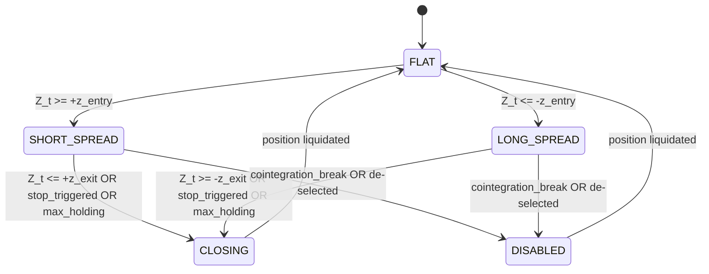

# Strategy Specification: Statistical Arbitrage & Equity Market Neutral

## 1. Executive Summary

This document specifies the research design and operational mechanics of an institutional-grade, quantitative **Statistical Arbitrage & Equity Market Neutral (EMN)** strategy. The strategy discovers pairs of liquid equities exhibiting statistically rigorous, cointegrated price relationships, models their deviations via an Ornstein-Uhlenbeck (OU) mean-reverting process, and executes dollar- and beta-hedged relative value positions while rigorously accounting for transaction costs, market slippage, and execution timing delays.

---

## 2. Market Universe & Eligibility Criteria

### 2.1 Baseline Universe
- **Target Equities**: US-listed common equities (NYSE, NASDAQ).
- **Benchmark Proxy**: S&P 500 ETF (SPY) for beta calculation and market neutrality attribution.
- **Data Frequency**: Daily adjusted close, open, high, low, volume (OHLCV).

### 2.2 Point-in-Time Eligibility Filters
At each walk-forward formation boundary $T_{\text{formation}}$, only securities satisfying the following filters across the formation lookback window $[T_{\text{formation}} - W, T_{\text{formation}}]$ are eligible:
1. **Minimum Price**: Trailing median close price $P_{\text{median}} \ge \$5.00$ (prevents low-liquidity penny stock microstructure distortion).
2. **Liquidity / Dollar Volume**: Trailing 60-day Average Daily Volume (ADV) $\times$ median price $\ge \$5,000,000$ (ensures capacity and minimizes market impact).
3. **Data Completeness**: Missing observations $\le 2.0\%$ of expected trading sessions in the formation window. Zero forward-fill across prolonged missing blocks.
4. **Listing Longevity**: At least $W$ valid trading days of continuous history.
5. **Sector/Industry Classification**: GICS sector and industry group grouping to ensure economic plausibility and shared structural risk drivers.

---

## 3. Economic Hypothesis & Pair Relationship

### 3.1 Long-Run Cointegrating Equilibrium
Let $P_A(t)$ and $P_B(t)$ denote the adjusted prices of two economically linked assets in the same sector. We hypothesize that their log-prices share a common stochastic trend $I(1)$, such that a linear combination yields a stationary $I(0)$ residual process:

$$\log(P_A(t)) = \alpha + \beta \log(P_B(t)) + \epsilon_t$$

Where:
- $\beta$ is the cointegrating hedge ratio.
- $\alpha$ is the structural drift/intercept.
- $\epsilon_t \sim I(0)$ is the mean-reverting residual spread $S_t$.

The candidate spread at time $t$ is defined as:
$$S_t = \log(P_A(t)) - \alpha - \beta \log(P_B(t))$$

### 3.2 Discrete-Time Ornstein-Uhlenbeck Process
The stationary spread $S_t$ is modeled as a continuous Ornstein-Uhlenbeck process discretized at daily intervals:
$$dS_t = \theta (\mu - S_t) dt + \sigma dW_t$$

In discrete autoregressive form:
$$\Delta S_t = S_t - S_{t-1} = a + b S_{t-1} + u_t$$
where:
- $\theta = -b / \Delta t$ is the mean-reversion speed.
- Half-life of mean reversion: $t_{1/2} = -\frac{\ln(2)}{b}$.

Mean reversion is economically valid only when $b < 0$. If $b \ge 0$, the relationship is explosive or a random walk, and the pair is rejected immediately.

---

## 4. Signal Generation & Position State Machine

### 4.1 Causal Rolling Z-Score
To prevent look-ahead bias, the spread mean $\mu_{t-1}$ and spread standard deviation $\sigma_{t-1}$ are estimated over a strictly lagged rolling window of length $L$ ending at time $t-1$:

$$\mu_{t-1} = \frac{1}{L} \sum_{i=1}^{L} S_{t-i}$$
$$\sigma_{t-1} = \sqrt{\frac{1}{L-1} \sum_{i=1}^{L} (S_{t-i} - \mu_{t-1})^2}$$

The standardized Z-score observed at close $t$ is:
$$Z_t = \frac{S_t - \mu_{t-1}}{\sigma_{t-1}}$$

### 4.2 Dynamic Bollinger Envelopes
To account for time-varying volatility clustering (heteroskedasticity), dynamic envelopes are defined as:
$$U_t = \mu_{t-1} + k_{\text{band}} \sigma_{t-1}, \quad L_t = \mu_{t-1} - k_{\text{band}} \sigma_{t-1}$$
Signals require both Z-score threshold penetration and confirmation relative to the volatility envelope.

### 4.3 Position State Machine
For each active pair, the signal engine tracks a deterministic finite state machine (FSM):

- **FLAT**: No open position.
- **SHORT_SPREAD**: Spread is overvalued ($Z_t \ge +z_{\text{entry}}$, baseline $+2.0$). Enter: Short asset $A$, Long asset $B$.
- **LONG_SPREAD**: Spread is undervalued ($Z_t \le -z_{\text{entry}}$, baseline $-2.0$). Enter: Long asset $A$, Short asset $B$.
- **CLOSING**: Triggered when $|Z_t| \le z_{\text{exit}}$ (baseline $0.0$), or stop loss reached ($|Z_t| \ge z_{\text{stop}}$, baseline $3.5$), or holding period exceeds $H_{\max}$ (baseline $3 \times t_{1/2}$ or 30 days).
- **DISABLED**: Structural cointegration breakdown or security liquidity failure; triggers orderly liquidation.

Duplicate orders are strictly prohibited while in an open state.

---

## 5. Portfolio Construction & Neutrality

### 5.1 Pair-Level Sizing (Volatility-Scaled Risk Budgeting)
Let $C_{\text{avail}}$ be total portfolio equity and $N_{\text{active}}$ be the target number of pairs. The base allocation to pair $p$ is weighted by the inverse of its spread volatility:

$$w_p^{\text{raw}} = \frac{1 / \sigma_p}{\sum_{j=1}^{N_{\text{active}}} (1 / \sigma_j)}$$

### 5.2 Pair Neutrality & Capital Allocation
For pair $p = (A, B)$ with allocated dollar capital $C_p$:
- If Long Spread ($S_t < -z_{\text{entry}}$):
  - Long Asset $A$: Dollar allocation $+C_p / (1 + |\beta_p|)$
  - Short Asset $B$: Dollar allocation $-\beta_p C_p / (1 + |\beta_p|)$
- If Short Spread ($S_t > +z_{\text{entry}}$):
  - Short Asset $A$: Dollar allocation $-C_p / (1 + |\beta_p|)$
  - Long Asset $B$: Dollar allocation $+\beta_p C_p / (1 + |\beta_p|)$

This ensures the pair position satisfies the estimated cointegrating ratio $\beta_p$ in log/notional terms.

### 5.3 Beta Neutrality Constraint (Optional Factor Adjustment)
Individual asset market betas $\beta_A^{\text{mkt}}, \beta_B^{\text{mkt}}$ are estimated against SPY over the formation window. When beta neutrality is active, the pair's leg weights are adjusted such that:
$$w_A \beta_A^{\text{mkt}} + w_B \beta_B^{\text{mkt}} = 0$$

### 5.4 Portfolio-Level Exposure Constraints
1. **Maximum Capital per Pair**: $|C_p| / C_{\text{equity}} \le 10\%$.
2. **Maximum Single-Stock Exposure**: Across all pairs, aggregate exposure to any single ticker $\sum_p |w_{i, p}| \le 15\%$.
3. **Maximum Sector Exposure**: Aggregate net exposure per sector $\le 25\%$.
4. **Gross Exposure Limit**: $\text{Gross} = \frac{\sum_i |w_i|}{C_{\text{equity}}} \le 1.0$ (or configurable up to $2.0$).
5. **Net Dollar Exposure**: $\text{Net} = \frac{\sum_i w_i}{C_{\text{equity}}} \in [-0.05, +0.05]$ (targeting exact dollar neutrality).

---

## 6. Execution & Transaction Cost Model

### 6.1 Information Timing Convention (Zero Look-Ahead)
- **Time $t$ (Market Close)**: OHLCV prices for day $t$ become observable. Daily spread, rolling Z-score, and state transition signals are computed after the market close.
- **Time $t+1$ (Market Open)**: Target orders generated at close $t$ are executed at day $t+1$ Open price (or volume-weighted open auction price).
- No trades are executed at day $t$ Close price under any circumstance.

### 6.2 Transaction Costs
1. **Slippage**: **5 basis points (0.05%)** per traded side applied to traded notional:
   $$\text{Cost}_{\text{slip}} = 0.0005 \times |\text{Traded Notional}|$$
2. **Broker Commission**: Configurable, default $\$0.001$ per share or 1 bp of notional.
3. **Borrow Fee (Short Positions)**: Annualized borrow fee (default 50 bps, $0.0050 / 252$ per day) charged on overnight short market value.
4. **Financing Cost / Cash Yield**: Overnight cash interest credited on unencumbered cash balance at risk-free rate proxy.

---

## 7. Walk-Forward Schedule

The pipeline utilizes rolling chronological walk-forward segments:
- **Formation Window ($W_F$)**: 252 trading days (1 calendar year).
- **Validation Window ($W_V$)**: 63 trading days (approx. 3 months) for stability diagnostics.
- **Trading Window ($W_T$)**: 63 trading days (quarterly rebalancing of pair membership).
- **Re-estimation Frequency**: Quarterly or rolling dynamic hedge ratio updates.

All performance figures reported as headline strategy performance originate exclusively from concatenated out-of-sample trading windows.
